  

  

    
    
  

👋 About Me
I'm Nafis Quaisar, a software developer with a primary focus on Android development. I enjoy building practical mobile applications, improving user experiences, and learning the engineering practices behind maintainable software.
- 📱 Focused on Android development with Kotlin and Java
- 🧱 Worked with MVVM, Firebase, and local data storage
- 🎧 Built TuneLyf, an Android music streaming app published on Google Play
- 📚 Built projects across mobile apps, education, and productivity
- 🌱 Always learning, experimenting, and improving through hands-on projects
🛠️ Tech Stack
Languages

Mobile Development

Architecture, Data & Tools

🚀 Featured Projects
<table>
  <tr>
    <td width="50%" valign="top">
      <h3>🎵 <a href="https://github.com/nafisquaisar/Tunelyf">TuneLyf</a></h3>
      
An Android music app for online streaming and local playback, with playlists, background playback, and media notification controls.

      
<strong>Built with:</strong> Kotlin, MVVM, ExoPlayer, Retrofit, Room, Firebase

      
<a href="https://play.google.com/store/apps/details?id=com.song.nafis.nf.TuneLyf">Get it on Google Play</a>

    </td>
    <td width="50%" valign="top">
      <h3>📚 <a href="https://github.com/nafisquaisar/Organizer_Classes">Organizer Classes</a></h3>
      
An education app featuring learning videos, notes, previous-year questions, doubt support, tests, and paid course access.

      
<strong>Built with:</strong> Kotlin, XML, Firebase, Razorpay

      
<a href="https://play.google.com/store/apps/details?id=com.nafis.organizerclasses">Get it on Google Play</a>

    </td>
  </tr>
  <tr>
    <td width="50%" valign="top">
      <h3>🧾 <a href="https://github.com/nafisquaisar/kharchaplus">Kharcha Plus</a></h3>
      
An expense and utility tracking app focused on organizing everyday spending and household usage data.

      
<strong>Built with:</strong> Flutter, Isar, Firebase / Firestore

    </td>
    <td width="50%" valign="top">
      <h3>🗒️ <a href="https://github.com/nafisquaisar/Small_Steps">Small Steps</a></h3>
      
A personal project repository. Visit the repository for current implementation details.

      
<strong>Source:</strong> GitHub

    </td>
  </tr>
</table>

📈 GitHub Contributions

  

This graph is loaded from a community-maintained service using public GitHub contribution data. If it stops rendering, remove or replace the image rather than substituting made-up activity.

🤝 Connect
- GitHub: @nafisquaisar
- LinkedIn: Nafis Quaisar

  
  Built with curiosity, consistency, and a love for building software.

